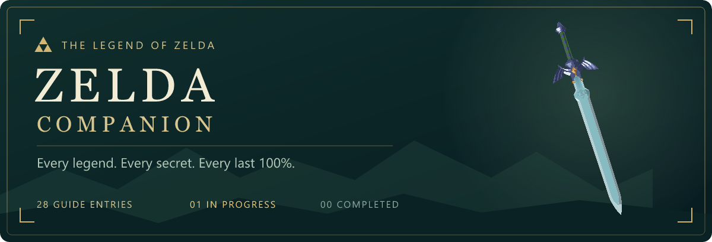
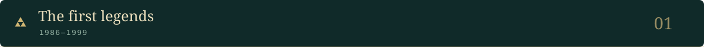
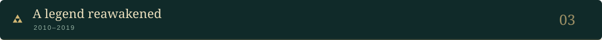
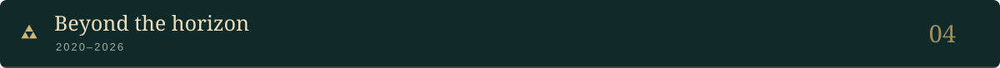

<!-- Zelda Companion profile. Statuses describe GUIDE development, not playthrough completion. -->

  

  <b>A guide to every corner of Hyrule — and every adventure beyond it.</b> 
  Building a library of 100% guides for The Legend of Zelda series.

  

### The quest key

These symbols track **100% guide development**.

| Symbol | Guide status |
| :---: | :--- |
|  | **Not working on it / Not started** |
|  | **Completed / Updates may happen** |
|  | **Currently working on it** |

### The adventure register

The official mainline games — **original adventures, remakes, and remasters** — in **first worldwide release order**. Years may differ from your region’s release. Games released together share a position in the chronology. Breath of the Wild and Tears of the Kingdom each include their Nintendo Switch 2 Edition in the original game’s guide entry, retaining their original 2017 and 2023 release years.

  

| Status | Released | Game / Edition | Platform |
| :---: | :---: | :--- | :--- |
|  | 1986 | The Legend of Zelda Original | Famicom Disk System / NES |
|  | 1987 | Zelda II: The Adventure of Link Original | Famicom Disk System / NES |
|  | 1991 | The Legend of Zelda: A Link to the Past Original | Super Nintendo |
|  | 1993 | The Legend of Zelda: Link&#x27;s Awakening Original | Game Boy |
|  | 1998 | The Legend of Zelda: Ocarina of Time Original | Nintendo 64 |

  

| Status | Released | Game / Edition | Platform |
| :---: | :---: | :--- | :--- |
|  | 2000 | The Legend of Zelda: Majora&#x27;s Mask Original | Nintendo 64 |
|  | 2001 | The Legend of Zelda: Oracle of Seasons Original | Game Boy Color |
|  | 2001 | The Legend of Zelda: Oracle of Ages Original | Game Boy Color |
|  | 2002 | The Legend of Zelda: Four Swords Original | Game Boy Advance |
|  | 2002 | The Legend of Zelda: The Wind Waker Original | Nintendo GameCube |
|  | 2004 | The Legend of Zelda: Four Swords Adventures Original | Nintendo GameCube |
|  | 2004 | The Legend of Zelda: The Minish Cap Original | Game Boy Advance |
|  | 2006 | The Legend of Zelda: Twilight Princess Original | Wii / Nintendo GameCube |
|  | 2007 | The Legend of Zelda: Phantom Hourglass Original | Nintendo DS |
|  | 2009 | The Legend of Zelda: Spirit Tracks Original | Nintendo DS |

  

| Status | Released | Game / Edition | Platform |
| :---: | :---: | :--- | :--- |
|  | 2011 | The Legend of Zelda: Ocarina of Time 3D Remake | Nintendo 3DS |
|  | 2011 | The Legend of Zelda: Skyward Sword Original | Wii |
|  | 2013 | The Legend of Zelda: The Wind Waker HD Remaster | Wii U |
|  | 2013 | The Legend of Zelda: A Link Between Worlds Original | Nintendo 3DS |
|  | 2015 | The Legend of Zelda: Majora&#x27;s Mask 3D Remake | Nintendo 3DS |
|  | 2015 | The Legend of Zelda: Tri Force Heroes Original | Nintendo 3DS |
|  | 2016 | The Legend of Zelda: Twilight Princess HD Remaster | Wii U |
|  | 2017 | **The Legend of Zelda: Breath of the Wild** Original + Nintendo Switch 2 Edition | Wii U / Nintendo Switch / Nintendo Switch 2 |
|  | 2019 | The Legend of Zelda: Link&#x27;s Awakening (Nintendo Switch) Remake | Nintendo Switch |

  

| Status | Released | Game / Edition | Platform |
| :---: | :---: | :--- | :--- |
|  | 2021 | The Legend of Zelda: Skyward Sword HD Remaster | Nintendo Switch |
|  | 2023 | The Legend of Zelda: Tears of the Kingdom Original + Nintendo Switch 2 Edition | Nintendo Switch / Nintendo Switch 2 |
|  | 2024 | The Legend of Zelda: Echoes of Wisdom Original | Nintendo Switch |
|  | 2026 | The Legend of Zelda: Ocarina of Time (Nintendo Switch 2) Remake | Nintendo Switch 2 |

<b>About the catalog & release-order sources</b>

This register covers the official mainline originals, remakes, and remasters. Spin-offs, ports, compilations, unofficial games, demos, DLC, and unreleased games are excluded. Link’s Awakening DX, Four Swords Anniversary Edition, Ocarina of Time Master Quest, and the Game Boy Advance port of A Link to the Past do not have separate entries. The original Four Swords remains because it is a distinct mainline adventure, even though it shared a cartridge with the GBA port of A Link to the Past.

The clock belongs only to **Breath of the Wild (2017)**, including its Nintendo Switch 2 Edition. **Tears of the Kingdom (2023)** also groups its Nintendo Switch 2 Edition into its original entry and keeps a red X. Both Switch 2 editions released June 5, 2025; their guides remain positioned at the original games’ 2017 and 2023 release years. Every other guide entry has a red X. No guide is marked completed yet.

Dates are based on [Nintendo’s Japanese game history](https://www.nintendo.com/jp/character/zelda/history/index.html?lang=ja), [Nintendo’s current game history](https://www.nintendo.com/us/explore/characters/zelda/history/), and the [Zelda media catalog](https://en.wikipedia.org/wiki/List_of_The_Legend_of_Zelda_media). The Ocarina of Time remake for Nintendo Switch 2 released on [November 5, 2026](https://www.nintendo.com/us/whatsnew/its-time-experience-the-legend-of-zelda-ocarina-of-time-reborn-exclusively-for-nintendo-switch-2/).

See [the catalog notes](SOURCES.md) for additional references and release-date details.

Catalog checked November 18, 2026.

  

An independent fan guide project. The Legend of Zelda and Master Sword artwork © Nintendo. <a href="SOURCES.md#artwork">Artwork credit</a>.

