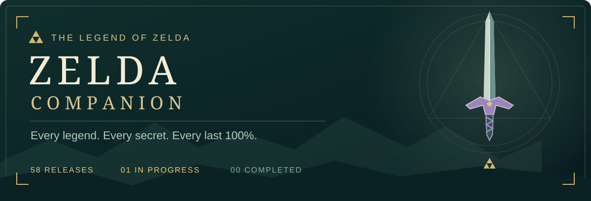
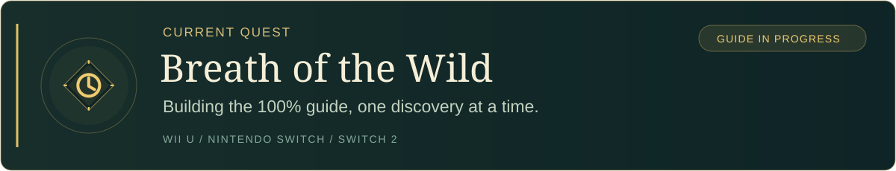
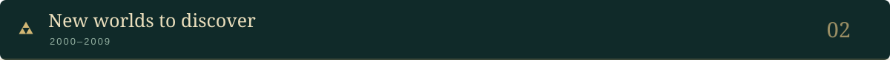

<!-- Zelda Companion profile. Statuses describe GUIDE development, not playthrough completion. -->

  

  <b>A guide to every corner of Hyrule — and every adventure beyond it.</b> 
  Building a library of 100% guides for The Legend of Zelda series.

  

### The quest key

These symbols track **100% guide development**.

| Symbol | Guide status |
| :---: | :--- |
|  | **Not working on it / Not started** |
|  | **Completed / Updates may happen** |
|  | **Currently working on it** |

### The adventure register

Original adventures, remakes, remasters, enhanced editions, dedicated spin-offs, and collections — in **first worldwide release order**. Years may differ from your region’s release. Games released together share a position in the chronology.

  

| Status | Released | Game / Edition | Platform |
| :---: | :---: | :--- | :--- |
|  | 1986 | The Legend of Zelda Original | Famicom Disk System / NES |
|  | 1987 | Zelda II: The Adventure of Link Original | Famicom Disk System / NES |
|  | 1989 | Zelda (Game &amp; Watch) Original LCD game | Game &amp; Watch |
|  | 1989 | The Legend of Zelda Game Watch Licensed LCD game | Nelsonic Game Watch |
|  | 1991 | The Legend of Zelda: A Link to the Past Original | Super Nintendo |
|  | 1992 | Zelda no Densetsu: Kamigami no Triforce (Barcode Battler II) Licensed adaptation | Barcode Battler II |
|  | 1993 | The Legend of Zelda: Link&#x27;s Awakening Original | Game Boy |
|  | 1993 | Link: The Faces of Evil Licensed adventure | Philips CD-i |
|  | 1993 | Zelda: The Wand of Gamelon Licensed adventure | Philips CD-i |
|  | 1995 | BS Zelda no Densetsu Broadcast remake | Super Famicom / Satellaview |
|  | 1995 | BS Zelda no Densetsu: MAP2 Remixed broadcast quest | Super Famicom / Satellaview |
|  | 1996 | Zelda&#x27;s Adventure Licensed adventure | Philips CD-i |
|  | 1997 | BS The Legend of Zelda: Ancient Stone Tablets Original broadcast adventure | Super Famicom / Satellaview |
|  | 1998 | The Legend of Zelda: Ocarina of Time Original | Nintendo 64 |
|  | 1998 | The Legend of Zelda: Link&#x27;s Awakening DX Enhanced | Game Boy Color |

  

| Status | Released | Game / Edition | Platform |
| :---: | :---: | :--- | :--- |
|  | 2000 | The Legend of Zelda: Majora&#x27;s Mask Original | Nintendo 64 |
|  | 2001 | The Legend of Zelda: Oracle of Seasons Original | Game Boy Color |
|  | 2001 | The Legend of Zelda: Oracle of Ages Original | Game Boy Color |
|  | 2002 | The Legend of Zelda: Ocarina of Time Master Quest Reworked | Nintendo GameCube |
|  | 2002 | The Legend of Zelda: A Link to the Past (Game Boy Advance) Enhanced | Game Boy Advance |
|  | 2002 | The Legend of Zelda: Four Swords Original | Game Boy Advance |
|  | 2002 | The Legend of Zelda: The Wind Waker Original | Nintendo GameCube |
|  | 2003 | The Legend of Zelda: Collector’s Edition Collection | GameCube |
|  | 2004 | The Legend of Zelda: Four Swords Adventures Original | Nintendo GameCube |
|  | 2004 | Navi Trackers Included multiplayer game | Nintendo GameCube |
|  | 2004 | The Legend of Zelda: The Minish Cap Original | Game Boy Advance |
|  | 2006 | Freshly-Picked Tingle&#x27;s Rosy Rupeeland Original spin-off | Nintendo DS |
|  | 2006 | The Legend of Zelda: Twilight Princess Original | Wii / Nintendo GameCube |
|  | 2007 | Tingle&#x27;s Balloon Fight DS Spin-off remake | Nintendo DS |
|  | 2007 | The Legend of Zelda: Phantom Hourglass Original | Nintendo DS |
|  | 2007 | Link&#x27;s Crossbow Training Original spin-off | Wii |
|  | 2009 | Dekisugi Tingle Pack Tools and minigames | Nintendo DSi / DSiWare |
|  | 2009 | Irozuki Tingle no Koi no Balloon Trip Original spin-off | Nintendo DS |
|  | 2009 | The Legend of Zelda: Spirit Tracks Original | Nintendo DS |

  

| Status | Released | Game / Edition | Platform |
| :---: | :---: | :--- | :--- |
|  | 2011 | The Legend of Zelda: Ocarina of Time 3D Remake | Nintendo 3DS |
|  | 2011 | The Legend of Zelda: Four Swords Anniversary Edition Enhanced | Nintendo DSi / Nintendo 3DS |
|  | 2011 | The Legend of Zelda: Skyward Sword Original | Wii |
|  | 2013 | The Legend of Zelda: The Wind Waker HD Remaster | Wii U |
|  | 2013 | The Legend of Zelda: A Link Between Worlds Original | Nintendo 3DS |
|  | 2014 | Hyrule Warriors Original spin-off | Wii U |
|  | 2015 | The Legend of Zelda: Majora&#x27;s Mask 3D Remake | Nintendo 3DS |
|  | 2015 | The Legend of Zelda: Tri Force Heroes Original | Nintendo 3DS |
|  | 2016 | Hyrule Warriors Legends Expanded port | Nintendo 3DS |
|  | 2016 | The Legend of Zelda: Twilight Princess HD Remaster | Wii U |
|  | 2016 | My Nintendo Picross: The Legend of Zelda: Twilight Princess Puzzle spin-off | Nintendo 3DS |
|  | 2017 | **The Legend of Zelda: Breath of the Wild** Original | Wii U / Nintendo Switch |
|  | 2018 | Hyrule Warriors: Definitive Edition Enhanced compilation | Nintendo Switch |
|  | 2019 | Cadence of Hyrule: Crypt of the NecroDancer Featuring The Legend of Zelda Crossover spin-off | Nintendo Switch |
|  | 2019 | The Legend of Zelda: Link&#x27;s Awakening (Nintendo Switch) Remake | Nintendo Switch |

  

| Status | Released | Game / Edition | Platform |
| :---: | :---: | :--- | :--- |
|  | 2020 | Hyrule Warriors: Age of Calamity Original spin-off | Nintendo Switch |
|  | 2021 | The Legend of Zelda: Skyward Sword HD Remaster | Nintendo Switch |
|  | 2021 | Game &amp; Watch: The Legend of Zelda Collection + Zelda-themed Vermin | Game &amp; Watch |
|  | 2023 | The Legend of Zelda: Tears of the Kingdom Original | Nintendo Switch |
|  | 2024 | The Legend of Zelda: Echoes of Wisdom Original | Nintendo Switch |
|  | 2025 | The Legend of Zelda: Breath of the Wild – Nintendo Switch 2 Edition Enhanced | Nintendo Switch 2 |
|  | 2025 | The Legend of Zelda: Tears of the Kingdom – Nintendo Switch 2 Edition Enhanced | Nintendo Switch 2 |
|  | 2025 | Hyrule Warriors: Age of Imprisonment Original spin-off | Nintendo Switch 2 |
|  | 2026 | The Legend of Zelda: Ocarina of Time (Nintendo Switch 2) Remake | Nintendo Switch 2 |

<b>About the catalog & release-order sources</b>

The register includes the main series, named enhanced releases, dedicated Zelda/Tingle spin-offs, licensed LCD/CD-i/Barcode Battler games, Satellaview broadcasts, and the two named Zelda collections. Routine unchanged ports, Virtual Console/Nintendo Classics reissues, demos, DLC, unreleased games, and cameo appearances are not repeated. Four Swords and the enhanced GBA A Link to the Past are listed separately even though they share a cartridge. Navi Trackers was included in the Japanese Four Swords Adventures release.

The clock belongs only to **Breath of the Wild (2017)**. Its Nintendo Switch 2 Edition has its own red X, as do all other releases. No guide is marked completed yet.

Dates are based on [Nintendo’s Japanese game history](https://www.nintendo.com/jp/character/zelda/history/index.html?lang=ja), [Nintendo’s current game history](https://www.nintendo.com/us/explore/characters/zelda/history/), and the [Zelda media catalog](https://en.wikipedia.org/wiki/List_of_The_Legend_of_Zelda_media). The Ocarina of Time remake for Nintendo Switch 2 released on [November 5, 2026](https://www.nintendo.com/us/whatsnew/its-time-experience-the-legend-of-zelda-ocarina-of-time-reborn-exclusively-for-nintendo-switch-2/).

Zelda’s Adventure is placed in 1996 following [research based on contemporary CD-i magazines](https://zelda-temple.net/zeldas-adventure/); older catalogs give 1994 or 1995. Year-only dates for early licensed releases are ordered at their documented precision. See [the catalog notes](SOURCES.md) for additional references.

Catalog checked November 18, 2026.

  

An independent fan guide project. The Legend of Zelda and its characters belong to Nintendo.

